# ⚡ ZTest

<p align="center">
  
</p>

<p align="center">
  <strong>Fast, lightweight, native API & load testing — powered by Zig.</strong>
</p>

<p align="center">
  API Testing · Test Suites · Load Testing · Reports · CI/CD
</p>

<p align="center">
  
  
  
  
</p>

---

## 📍 Current State

> **Parts of this README describe the planned product.** What runs today is listed here; cross-platform desktop builds are still a design target.

What exists today:

- **`ztest api`** sends one HTTP or HTTPS request, prints the response, and checks it with `--assert`.
- **`ztest run`** runs `.ztest` files or directories with setup/teardown, `query` and `auth` statements, extracted values, environments and masked secrets from `ztest.json`. `--report json|junit|html[=path]` writes reports for CI (see [`docs/CI.md`](./docs/CI.md)).
- **`ztest load`** runs virtual users against one request with ramp-up and an optional rate limit, and prints RPS, failures and p50/p90/p95/p99 latency; `--report json` adds a per-second series.
- **`ztest init`** writes a starter `ztest.json` and `tests/example.ztest`.
- **`zest`**: a small unit-test library for Zig, in `src/root.zig`.
- **Desktop app** (Windows only): `zig build ui`. **API Tests** is a working request builder: method, URL, **Params** (`name=value` lines), **Headers** (`Name: value` lines), **Auth** (Basic, Bearer, API key in a header or query, with masked keys), **Body** (none, raw text or JSON), and **Tests** (one assertion per line, results in the Assertions panel). Start a Params, Headers or Tests line with `#` to switch it off. `{{variables}}` come from the nearest `ztest.json`; pick the environment in the top bar, and secrets are masked in the variable list and in responses. **Open** and **Save** read and write `.ztest` files, and a suite's tests can be stepped through with the `<` `>` buttons. **Test Suites** lists the `.ztest` files beside `ztest.json` and runs them with live results, Stop, and Export Report (HTML, JSON or JUnit). **Load Tests** runs virtual users with live charts. **Dashboard** and **Reports** read the run history the app keeps in `.ztest/history.jsonl`; **Environments** shows each environment's variables.

Desktop keyboard controls: **Ctrl+1–7** opens sidebar pages in order (**Ctrl+2**
opens API Tests). In API Tests, **Tab/Shift+Tab** moves between visible, enabled
controls; **Space** activates focused request/response tabs and the None/Raw body
modes. The format selector uses the arrow keys. **Ctrl+A** selects editor text,
and **Ctrl+Enter** sends or cancels a request from an editor. **Ctrl+S** saves,
**Ctrl+Shift+S** saves as, **Ctrl+O** opens, **Ctrl+N** starts a new request, and
**Ctrl+Page Up/Down** steps through the tests of an open suite. **Ctrl+K** searches
suites from any page, and **Enter** in a Load Tests field starts the test.

Install: download the archive for your platform from the
[releases page](https://github.com/Hoeur/zest/releases) (Windows, Linux and
macOS, x64 and ARM64), or build from source. See [`docs/INSTALL.md`](./docs/INSTALL.md).

Quick start from source:

```bash
zig build
zig-out/bin/ztest init my-api && cd my-api
../zig-out/bin/ztest run tests/ --report html
../zig-out/bin/ztest load https://httpbin.org/get --users 5 --duration 10s
```

Using `zest`:

```zig
const std = @import("std");
const zest = @import("zest");
const T = zest.T;

const MathTests = struct {
    pub fn addsNumbers(t: *T) !void {
        try t.equal(5, 2 + 3);
    }
};

pub fn main(init: std.process.Init) !void {
    try zest.run(init, .{MathTests});
}
```

Public functions in a suite that take `*T` are discovered at compile time. Optional `beforeEach` and `afterEach` run around each test, and `t.allocator` fails any test that leaks memory. A complete example is in [`examples/demo.zig`](./examples/demo.zig).

---

## 🎬 Demo

> Planned demo flow: create API request → run test → validate assertions → execute suite → inspect results.

Example animation sequence:

```text
Create Request
     ↓
Send Request
     ↓
Receive Response
     ↓
Run Assertions
     ↓
Save Test
     ↓
Run Suite
```

Asset layout (the GIFs have not been recorded yet):

```text
docs/
└── assets/
    ├── ztest-demo.gif
    ├── api-test.gif
    ├── load-test.gif
    ├── dashboard.png
    ├── api-builder.png
    ├── test-suites.png
    └── load-dashboard.png
```

---

## ✨ Overview

**ZTest** is a modern testing tool built with **Zig** for developers, QA engineers, backend engineers, and DevOps teams who want fast API testing and high-performance load testing without a heavyweight runtime.

The long-term idea:

```text
Postman
+
Newman
+
k6
+
Zig performance
=
ZTest
```

ZTest is designed around a single reusable core engine.

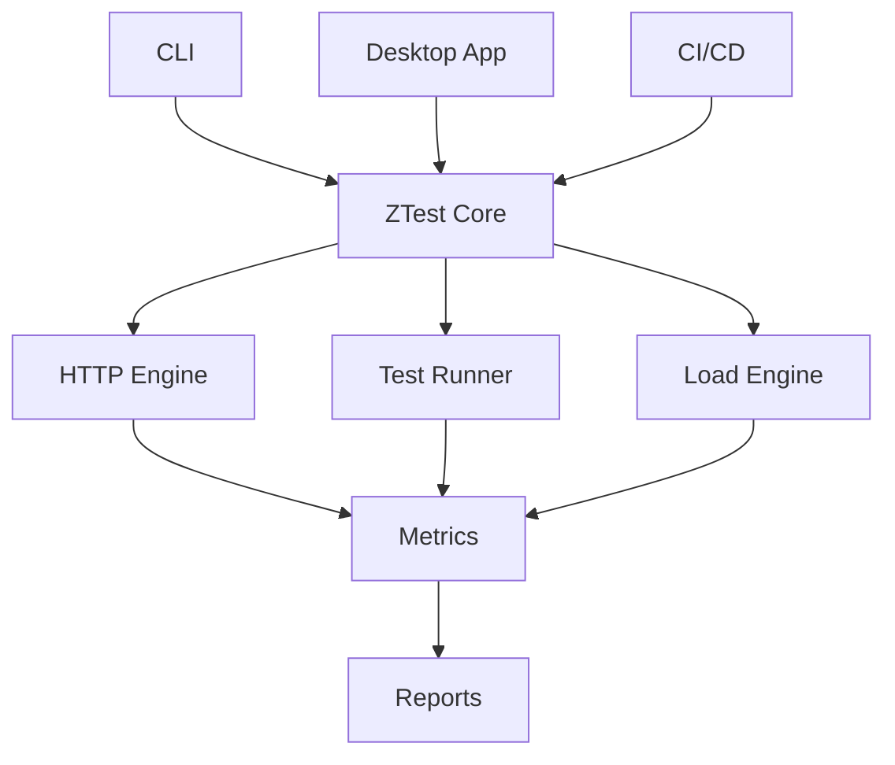

---

## 🚀 Why ZTest?

ZTest focuses on:

- ⚡ Fast startup
- 🧠 Low memory usage
- 📦 Small native binaries
- 🧪 API testing
- ✅ Assertions
- 🧩 Reusable test suites
- 🔥 Load testing
- 📊 Performance metrics
- 🖥 Native desktop UI
- 🤖 CI/CD automation
- 🔐 Secret-safe logging
- 🌍 Cross-platform support

---

## 🧭 Project Status

> ZTest is currently under active development.

Current development path:

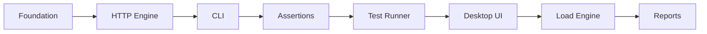

Target stable release:

```text
v1.0.0
```

---

## 🖼 UI Concepts

> These are design mockups, not screenshots. All data shown is illustrative.

### Dashboard

<p align="center">
  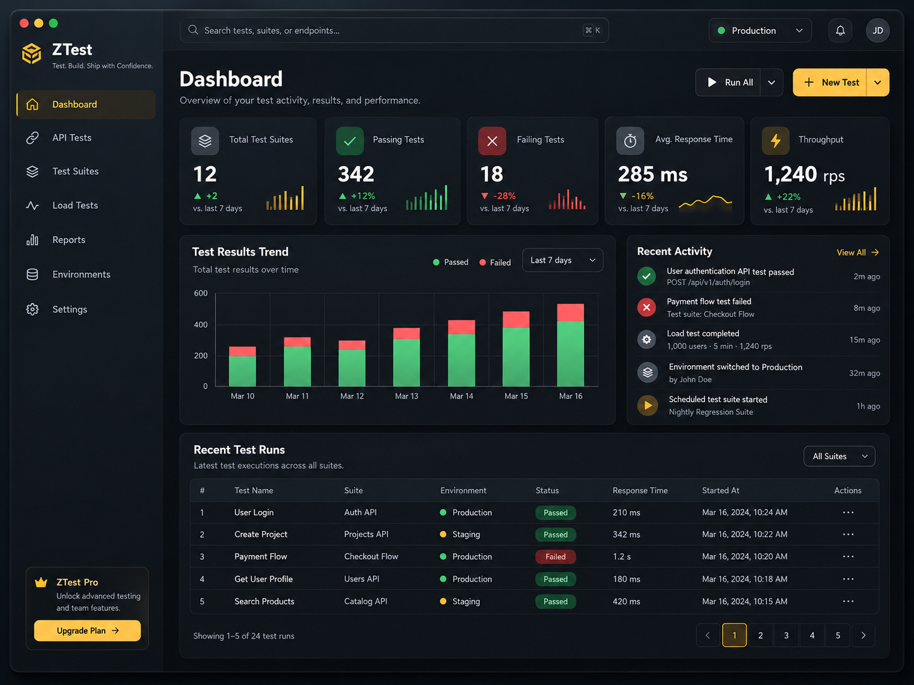
</p>

Dashboard focuses on:

- Total tests
- Passing tests
- Failing tests
- Response time
- Throughput
- Recent executions
- Test trends

---

### API Test Builder

<p align="center">
  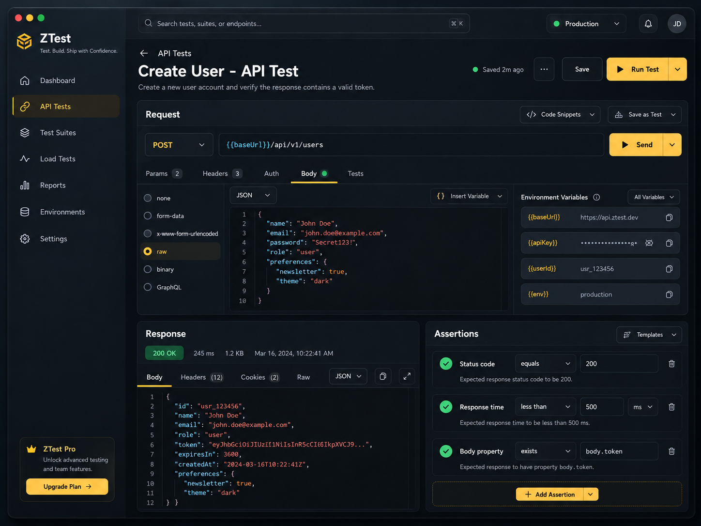
</p>

Main API workflow:

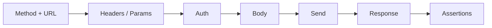

---

### Test Suites

<p align="center">
  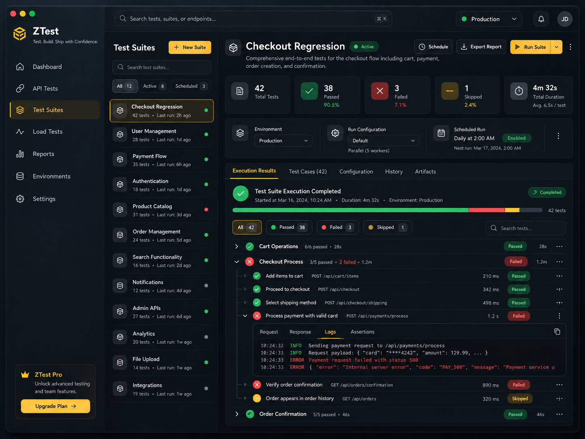
</p>

---

### Load Testing Dashboard

<p align="center">
  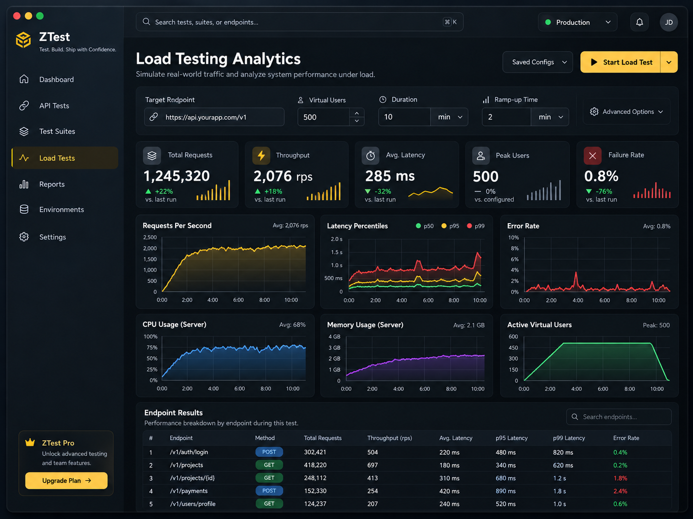
</p>

Load testing focuses on:

```text
Virtual Users
Duration
Ramp-up
RPS
Latency
p50
p95
p99
Errors
```

---

## 🎞 API Testing Animation

Suggested animation:

```text
Select POST
     ↓
Enter URL
     ↓
Add JSON body
     ↓
Send
     ↓
200 OK
     ↓
Add assertions
     ↓
Save test
```

---

## 🔥 Load Testing Animation

Suggested sequence:

```text
Configure Load
     ↓
500 Virtual Users
     ↓
10 Minute Duration
     ↓
2 Minute Ramp-up
     ↓
Start
     ↓
Live Metrics
     ↓
Performance Report
```

---

## 🏗 Architecture

ZTest uses a core-first architecture.

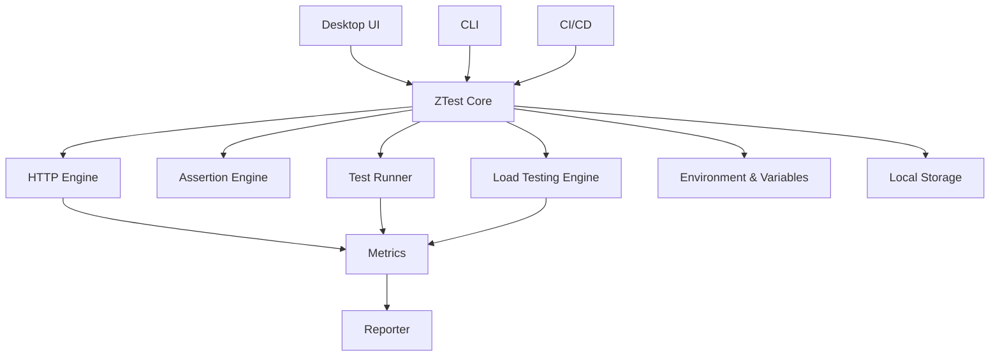

The desktop UI must not contain testing business logic.

```text
UI → Core ✅

Core → UI ❌
```

---

## 🔄 API Execution Flow

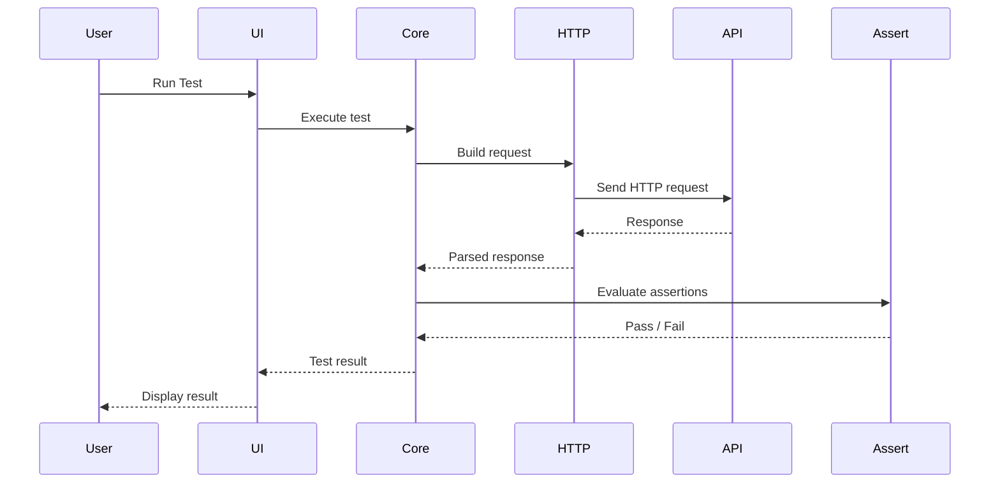

---

## 🔥 Load Testing Flow

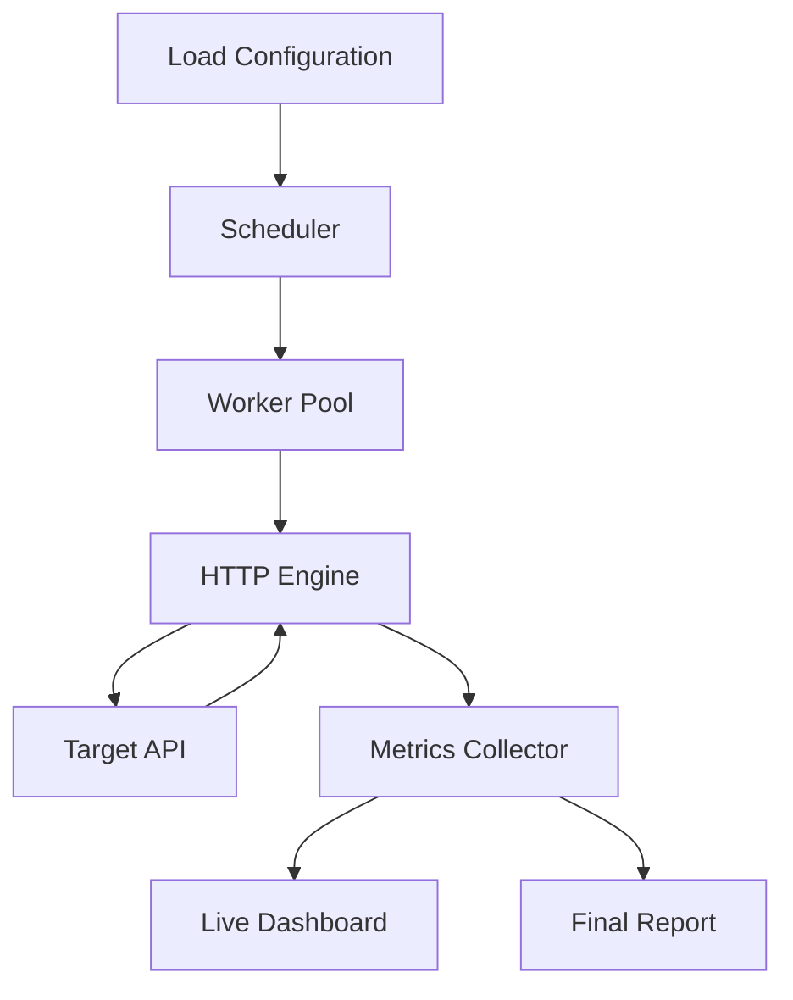

---

## 📦 Project Structure

Target structure:

```text
ztest/
├── build.zig
├── build.zig.zon
│
├── src/
│   ├── main.zig
│   │
│   ├── cli/
│   ├── core/
│   ├── http/
│   ├── assertions/
│   ├── parser/
│   ├── config/
│   ├── runner/
│   ├── load/
│   ├── metrics/
│   ├── reporter/
│   ├── storage/
│   └── ui/
│
├── tests/
│   ├── unit/
│   ├── integration/
│   └── e2e/
│
├── examples/
│
├── benchmarks/
│
├── docs/
│   ├── assets/
│   │   ├── ztest-demo.gif
│   │   ├── api-test.gif
│   │   ├── load-test.gif
│   │   ├── dashboard.png
│   │   ├── api-builder.png
│   │   ├── test-suites.png
│   │   └── load-dashboard.png
│   │
│   ├── CLI.md
│   ├── TEST_FORMAT.md
│   └── LOAD_TESTING.md
│
├── README.md
├── ROADMAP.md
├── TODO.md
└── ARCHITECTURE.md
```

---

## 🧪 API Testing

Planned methods:

```text
GET
POST
PUT
PATCH
DELETE
HEAD
OPTIONS
```

Example:

```bash
ztest api GET https://api.example.com/users
```

POST:

```bash
ztest api POST https://api.example.com/login \
  --json '{"email":"test@example.com","password":"123456"}'
```

Example output:

```text
POST https://api.example.com/login

Status     200 OK
Time       82 ms
Size       1.2 KB

{
  "success": true,
  "token": "..."
}
```

---

## ✅ Assertions

Check a response from the command line. Each failure is reported, and the command exits `1`:

```bash
ztest api GET https://api.example.com/users \
  --assert 'status == 200' \
  --assert 'response_time < 500ms' \
  --assert 'body.items[0].name == "Apple"' \
  --assert 'body.token exists' \
  --assert 'header.content-type contains "application/json"'
```

With `--raw`, the report goes to stderr so stdout stays pipeable.

The `.ztest` format uses the same expressions:

```text
expect status == 200
expect body.token exists
```

Operators:

```text
==
!=
>
<
>=
<=
exists
not_exists
contains
starts_with
ends_with
```

Execution flow:

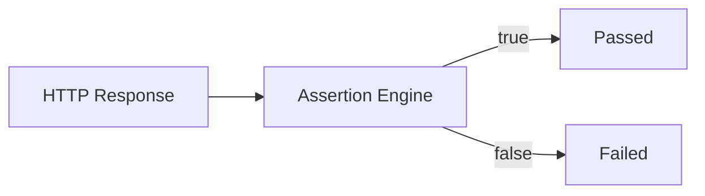

Example failure:

```text
✗ Login API

Expected:
status == 200

Actual:
status == 500
```

---

## 🧩 Test Suites

Example:

```text
suite "Authentication"

test "Login successfully"

POST {{baseUrl}}/api/login

header Content-Type application/json

body {
  "email": "test@example.com",
  "password": "123456"
}

expect status == 200
expect response_time < 500ms
expect body.token exists

end
```

Run:

```bash
ztest run tests/login.ztest
```

Run directory:

```bash
ztest run tests/
```

Suite workflow:

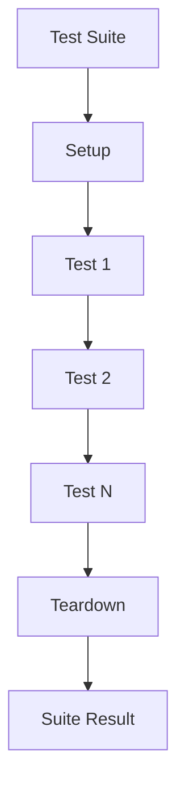

---

## 🌍 Environments

Environments are named sets of variables in `ztest.json`, and `--env` picks one:

```json
{
  "variables": { "version": "v1" },
  "environments": {
    "staging": {
      "baseUrl": "https://staging.example.com",
      "apiKey": { "env": "STAGING_API_KEY" }
    },
    "production": {
      "baseUrl": "https://api.example.com",
      "apiKey": { "env": "PRODUCTION_API_KEY" }
    }
  }
}
```

```bash
ztest run tests/ --env staging
```

Tests use them like any other variable:

```text
{{baseUrl}}/api/users
```

See [`docs/TEST_FORMAT.md`](docs/TEST_FORMAT.md#environments) for the details.

Variable priority:

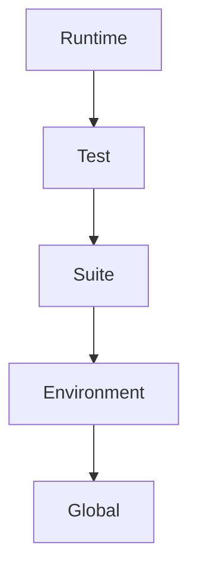

Higher scopes override lower scopes.

---

## 🔐 Secret Handling

Sensitive values must be protected.

```text
var secret apiKey = "..."
extract secret token = body.token
```

Values read with `{ "env": "NAME" }` in `ztest.json` are secret too, so keys need
not be stored in a file. `ztest run` prints `********` in their place:

```text
Actual:   body.key == "********"
```

Secrets are redacted from `ztest run` output and error messages today. The Desktop
UI and reports are planned, and will take the same masked results.

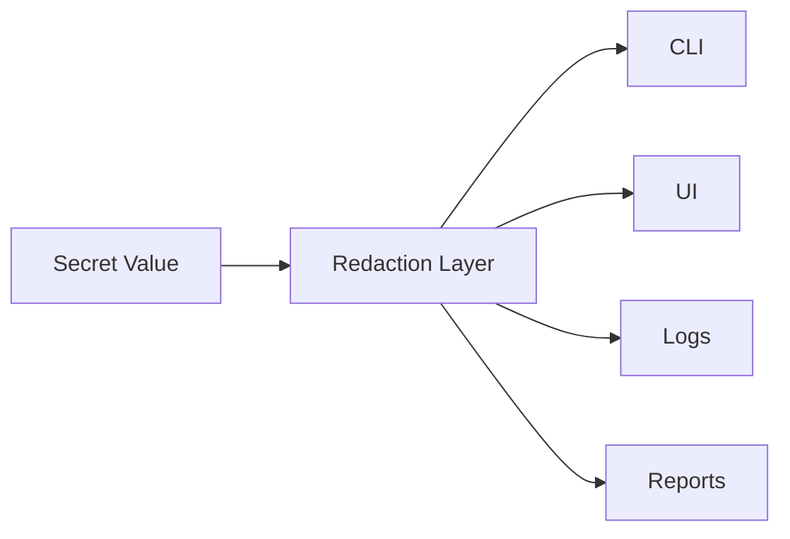

---

## 🔗 Response Extraction

Values from one response can feed later requests.

Example:

```text
extract token = body.token
```

Then:

```text
Authorization: Bearer {{token}}
```

Flow:

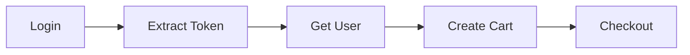

---

## 🔥 Load Testing

Example:

```bash
ztest load https://api.example.com/products \
  --users 500 \
  --duration 10m \
  --ramp-up 2m \
  --assert "status == 200"
```

Also available: `--rps <n>` to hold all users to a total rate, every `ztest api`
request flag (`-H`, `--query`, `--json`, `--body`, `--auth`, `--timeout`), and
`--report json=path` for totals, percentiles and a per-second series. Progress
prints once a second; Ctrl-C stops early and still prints the results.

Output (illustrative numbers):

```text
Load Test Complete

Total Requests            1245320
Successful                1235230
Failed                      10090
RPS                        2075.5
Failure Rate                0.81%
Duration                   600.0s

Average Latency          285 ms
Min Latency             0.92 ms
p50                      180 ms
p90                      402 ms
p95                      480 ms
p99                      820 ms
Max Latency             2210 ms
```

Users are capped at 1000 per process, because each user and each request in
flight runs on its own thread.

---

## 📊 Metrics

ZTest will collect:

| Metric | Description |
|---|---|
| Total Requests | Total HTTP requests |
| Successful | Successful responses |
| Failed | Failed responses |
| RPS | Requests per second |
| Avg Latency | Average response latency |
| p50 | Median latency |
| p90 | 90th percentile |
| p95 | 95th percentile |
| p99 | 99th percentile |
| Failure Rate | Failed request percentage |
| Active VUs | Active virtual users |
| Bytes Sent | Outbound traffic |
| Bytes Received | Inbound traffic |

---

## 🖥 Desktop App

Planned navigation:

```text
Dashboard
API Tests
Test Suites
Load Tests
Reports
Environments
Settings
```

Current UI stack (Windows only):

```text
Zig
+
Win32
+
GDI+
```

zgui and Dear ImGui were the original plan, but zgui has not been verified on Zig 0.17.

The desktop application should behave as a thin presentation layer above ZTest Core.

---

## 🧠 Core Design Principle

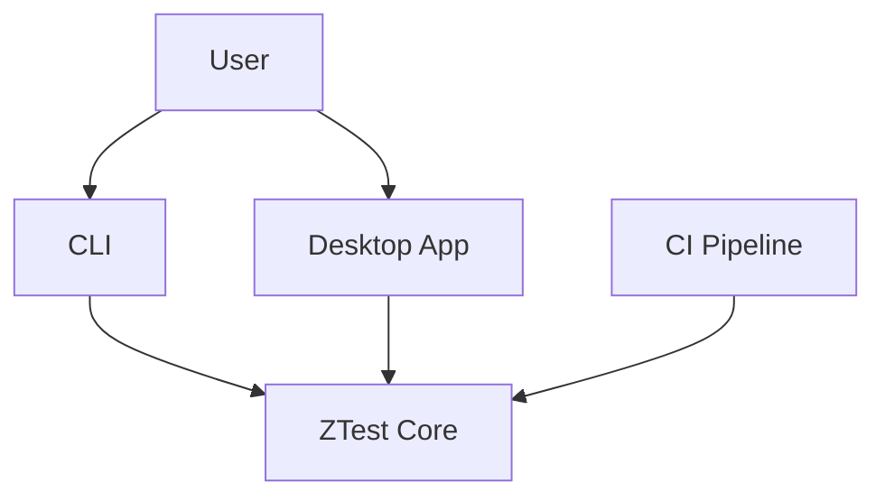

One engine.

Multiple interfaces.

---

## 📄 Reports

Formats: console (always), JSON, JUnit XML and a self-contained HTML page.
Each `--report` writes one file; add `=path` to choose where.

```bash
ztest run tests/ --report json
ztest run tests/ --report junit=reports/junit.xml
ztest run tests/ --report html=reports/report.html
ztest load https://api.example.com/health --users 10 --duration 30s --report json=load.json
```

Reports hold only masked values, so secrets from `ztest.json` never reach them.

---

## 🤖 CI/CD

```bash
ztest run tests/ --env staging --report junit=reports/junit.xml
```

Exit codes are stable (`0` passed, `1` failed, `2` configuration error, `3` internal error, `130` interrupted). [`docs/CI.md`](./docs/CI.md) has GitHub Actions, GitLab CI, Jenkins and Azure DevOps examples.

---

## 📚 Documentation

| Document | Purpose |
|---|---|
| [`README.md`](./README.md) | Project overview |
| [`ROADMAP.md`](./ROADMAP.md) | Development roadmap |
| [`TODO.md`](./TODO.md) | Engineering tasks |
| [`ARCHITECTURE.md`](./ARCHITECTURE.md) | System architecture |
| `docs/CLI.md` (planned) | CLI usage; `ztest --help` covers it today |
| [`docs/TEST_FORMAT.md`](./docs/TEST_FORMAT.md) | `.ztest` format |
| [`docs/INSTALL.md`](./docs/INSTALL.md) | Installing a release or building from source |
| [`docs/CI.md`](./docs/CI.md) | Running ZTest in CI |
| [`docs/RELEASING.md`](./docs/RELEASING.md) | Building release archives and publishing a release |
| [`CHANGELOG.md`](./CHANGELOG.md) | Changes in each release |
| [`docs/UI_PLATFORM.md`](./docs/UI_PLATFORM.md) | Cross-platform desktop UI evaluation |
| [`examples/api/`](./examples/api/) | Runnable example suites and an offline echo server |

---

## 💡 Principles

```text
Core first.
CLI second.
UI third.
```

```text
Correctness before optimization.
Benchmarks before assumptions.
One engine for every interface.
```

---

## 📜 License

ZTest is released under the [MIT License](LICENSE).

---

<p align="center">
  Built with ⚡ Zig
</p>

<p align="center">
  <strong>Test fast. Ship confidently.</strong>
</p>
