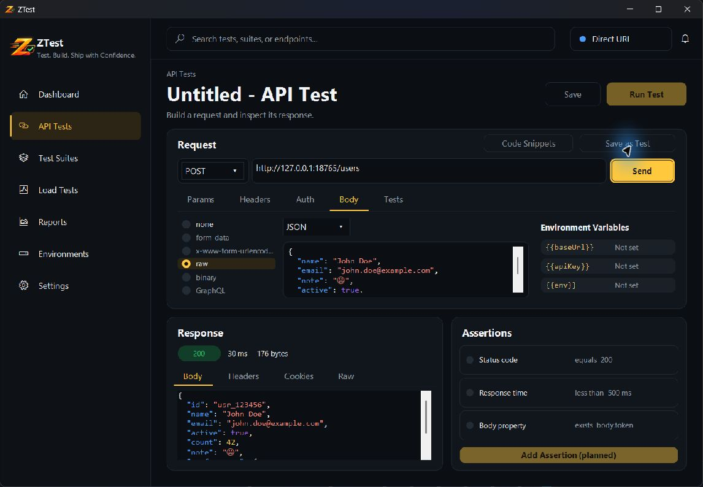

# ZTest

<p align="center">
  
</p>

ZTest is a lightweight tool for **API testing, automated test suites, and load testing**. Build and inspect requests in the Windows desktop app, then run the same suites from the command line or in CI.

[Download ZTest 0.1.0-alpha](https://github.com/Hoeur/zest/releases/tag/v0.1.0-alpha) · [Installation guide](docs/INSTALL.md) · [Changelog](CHANGELOG.md)

## Download

| Platform | x64 | ARM64 | Included |
| --- | --- | --- | --- |
| Windows | [ZIP](https://github.com/Hoeur/zest/releases/download/v0.1.0-alpha/ztest-0.1.0-alpha-x86_64-windows.zip) | [ZIP](https://github.com/Hoeur/zest/releases/download/v0.1.0-alpha/ztest-0.1.0-alpha-aarch64-windows.zip) | Desktop app and CLI |
| Linux | [tar.gz](https://github.com/Hoeur/zest/releases/download/v0.1.0-alpha/ztest-0.1.0-alpha-x86_64-linux.tar.gz) | [tar.gz](https://github.com/Hoeur/zest/releases/download/v0.1.0-alpha/ztest-0.1.0-alpha-aarch64-linux.tar.gz) | CLI |
| macOS | [Intel tar.gz](https://github.com/Hoeur/zest/releases/download/v0.1.0-alpha/ztest-0.1.0-alpha-x86_64-macos.tar.gz) | [Apple Silicon tar.gz](https://github.com/Hoeur/zest/releases/download/v0.1.0-alpha/ztest-0.1.0-alpha-aarch64-macos.tar.gz) | CLI |

Extract the archive. On Windows, open `ztest-ui.exe` for the desktop app. Add the extracted folder to your `PATH` to run `ztest` from a terminal.

## Quick start

Send an HTTP request and check the response.

```bash
ztest api GET https://httpbin.org/get --assert "status == 200"
```

Create a workspace, then run the generated suite and write an HTML report.

```bash
ztest init my-api
cd my-api
ztest run tests/ --report html
```

The starter suite uses httpbin. For a local run, use the [offline example suites](examples/api/README.md).

Run a short load test against a local service that you control.

```bash
ztest load http://127.0.0.1:8080/get --users 5 --duration 10s \
  --assert "status == 200" --report json
```

Use `ztest --help` for command options.

## API requests and test suites

- Configure request methods, URLs, query parameters, headers, Basic or Bearer auth, API keys, and JSON or raw bodies.
- Assert response status, timing, headers, and JSON values. Extract response values for use in later requests.
- Store reusable tests in `.ztest` files with setup and teardown. Switch environments with `ztest.json` and reference secrets through environment variables.
- Export JSON, JUnit, and HTML suite reports for local review or CI.

```text
suite "Health check"

test "Service responds"
  GET {{baseUrl}}/health
  expect status == 200
  expect response_time < 500ms
end
```

See the [suite and configuration reference](docs/TEST_FORMAT.md) and [CI examples](docs/CI.md).

## Load testing

Run concurrent virtual users against one endpoint with an optional ramp-up and request-rate limit. ZTest reports throughput, failures, and latency percentiles. The desktop app charts progress live, and the CLI can export the results and per-second metrics as JSON.

## Windows desktop app

- **API Tests** builds requests, checks assertions, and opens or saves `.ztest` files.
- **Test Suites** runs workspace tests with live results, cancellation, and report export.
- **Load Tests** configures virtual users and charts results as requests run.
- **Dashboard**, **Reports**, and **Environments** show run history, saved results, and workspace variables.



Use **Ctrl+1–7** to switch sidebar pages, **Ctrl+Enter** to send or cancel a request from an editor, and **Ctrl+K** to search suites.

## Project documentation

- [Installation and checksums](docs/INSTALL.md)
- [Test format and workspace configuration](docs/TEST_FORMAT.md)
- [CI integration](docs/CI.md)
- [Roadmap](ROADMAP.md) and [development checklist](TODO.md)
- [Architecture](ARCHITECTURE.md) and [release process](docs/RELEASING.md)

## License

[MIT](LICENSE)
